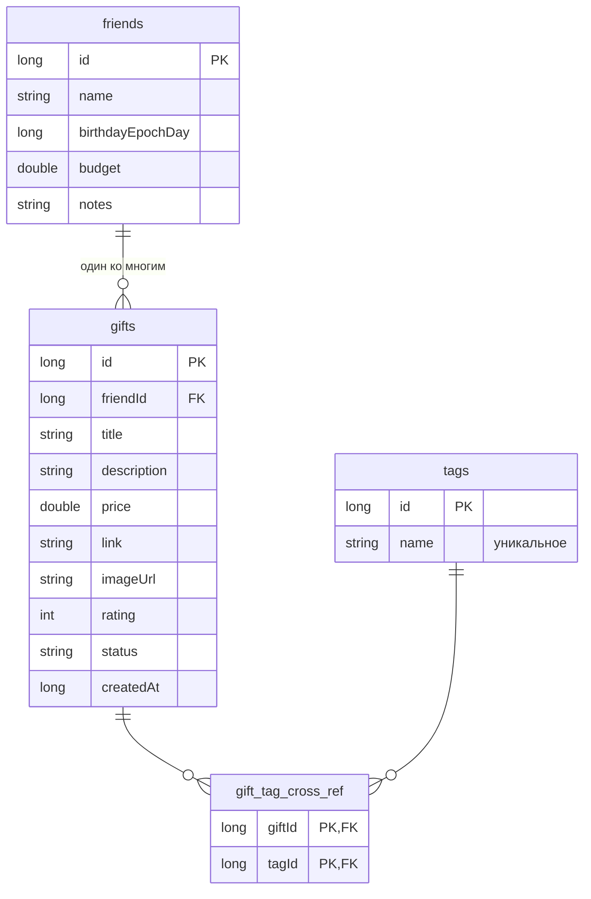

# Список подарков (GiftList)

Android-приложение, которое помогает не забывать про подарки: вы ведёте список друзей, для каждого
копите идеи подарков с ценой, рейтингом и ссылкой, следите за бюджетом, а перед днём рождения
приложение само напоминает, что пора выбирать подарок.

Учебный проект по МДК 01.03 «Разработка мобильных приложений», тема № 19 «Подарки».

## Возможности

- **Друзья**: имя, дата рождения, бюджет на подарки, заметки. Список отсортирован по ближайшему дню рождения,
  у каждого друга виден обратный отсчёт и сколько бюджета уже потрачено.
- **Подарки**: название, описание, цена, ссылка на магазин, фото по ссылке, рейтинг 1–5, статус
  (идея → куплен → подарен) и теги.
- **Поиск и фильтры**: поиск по названию, описанию и тегам; три фильтра (друг, статус, тег),
  которые работают вместе; сортировка (новые, по названию, по цене, по рейтингу).
- **Статистика**: числа (друзья, подарки, потрачено, в планах, средний рейтинг, ближайший праздник),
  круговая диаграмма по статусам и столбчатая диаграмма «бюджет и расходы» по каждому другу.
- **Настройки**: тема (светлая, тёмная, как в системе), сортировка по умолчанию, валюта,
  напоминания о днях рождения и за сколько дней напоминать. Все настройки сохраняются сразу.
- **Демо-данные**: одна кнопка в настройках заполняет приложение примерами, чтобы сразу увидеть
  графики и напоминания.

### «Изюминка»: напоминания о днях рождения

Раз в сутки фоновая задача (WorkManager) проверяет, у кого из друзей день рождения совсем скоро,
и присылает уведомление, которое зависит от состояния подарков этого друга:

- подарок ещё не выбран: «самое время добавить идею»;
- есть только идеи: предлагается идея с самым высоким рейтингом;
- подарок куплен: «осталось вручить».

Если у друга задан бюджет, в уведомлении сразу видно, сколько потрачено. Кнопка
«Показать тестовое уведомление» в настройках запускает проверку немедленно. Рейтинг подарка
в этой схеме не декорация: по нему приложение выбирает, какую идею напомнить.

## Экраны

| № | Экран | Что на нём |
|---|-------|------------|
| 1 | Список подарков (главный) | список, кнопка добавления, поиск, фильтры, сортировка |
| 2 | Добавление и редактирование | форма с проверкой ввода, кнопки «Сохранить» и «Отмена» |
| 3 | Детальный просмотр | все поля подарка, смена статуса, «Редактировать» и «Удалить» |
| 4 | Друзья | карточки друзей, добавление, правка и удаление |
| 5 | Статистика | числа и две диаграммы |
| 6 | Настройки | пять параметров, демо-данные |

Навигация: нижняя панель на четыре раздела (подарки, друзья, статистика, настройки), детали и форма
открываются поверх списка.

## База данных (Room / SQLite)



- **Основные таблицы:** `friends`, `gifts`, `tags`. **Промежуточная:** `gift_tag_cross_ref`.
- **Один ко многим:** один друг, много подарков. При удалении друга его подарки удаляются каскадом
  (`ForeignKey.CASCADE`).
- **Многие ко многим:** подарок может иметь несколько тегов, тег может относиться к нескольким подаркам.
  Связь хранится в `gift_tag_cross_ref`; тег, который больше не нужен ни одному подарку, удаляется.
- Сохранение подарка вместе с тегами выполняется в одной транзакции.
- Настройки хранятся отдельно, в DataStore.

## Архитектура

MVVM: экраны на Jetpack Compose только показывают состояние и передают действия пользователя,
вся логика находится во ViewModel, доступ к данным идёт через репозиторий.

```
app/src/main/java/com/example/wishlist228/
├── models/        сущности Room, перечисления, модели состояния экранов
├── database/      AppDatabase, DAO, GiftRepository, SettingsStore (DataStore), демо-данные
├── viewmodels/    GiftListViewModel, FriendsViewModel, StatsViewModel, SettingsViewModel
├── ui/
│   ├── screens/     шесть экранов
│   ├── components/  карточка подарка, рейтинг, диаграммы, диалоги, заглушки
│   ├── navigation/  маршруты и нижняя навигация
│   └── theme/       светлая и тёмная темы
├── utils/         поиск и сортировка, проверка форм, даты, деньги, статистика, уведомления
├── GiftListApplication.kt
└── MainActivity.kt
```

Работа с базой идёт вне главного потока: функции DAO это `suspend` и `Flow`, а обёртка `safeDbCall`
выполняет операции на `Dispatchers.IO` и превращает ошибки в понятное сообщение.

### Обработка ошибок и состояний

- Пустые или неверные поля подсвечиваются красным с пояснением, дополнительно показывается Snackbar.
- Удаление (подарка, друга, всех данных) всегда спрашивает подтверждение.
- Ошибка при сохранении не закрывает форму и не роняет приложение: пользователь видит сообщение.
- Пока данные загружаются, показывается индикатор; пока кнопка «Сохранить» работает, она заблокирована.
- Если списки пусты, показывается заглушка с подсказкой и кнопкой «добавить первую запись».
- Без интернета приложение работает полностью, так как база локальная. Если фото по ссылке не загрузилось,
  вместо него показывается значок.

## Технологии

Kotlin 2.0, Jetpack Compose (Material 3), Navigation Compose, Room (через KSP), DataStore, WorkManager,
Coil (фото), MPAndroidChart (диаграммы), JUnit.

## Сборка и запуск

1. Откройте папку проекта в **Android Studio** (подойдёт актуальная версия, JDK 11 и новее).
2. Дождитесь синхронизации Gradle. Нужен доступ в интернет: библиотека MPAndroidChart подключается
   с JitPack, остальное берётся с Google Maven и Maven Central.
3. Запустите конфигурацию **app** на эмуляторе или телефоне с Android 8.0 (API 26) и новее.
4. Чтобы сразу увидеть данные, откройте «Настройки» и нажмите «Добавить демо-данные».

Сборка из командной строки: `./gradlew assembleDebug`. Модульные тесты: `./gradlew test`.

## Тесты

Логика, не зависящая от Android, покрыта модульными тестами: поиск, фильтры и сортировка
(`GiftQueryTest`), проверка форм (`FormValidatorTest`), даты и обратный отсчёт до дня рождения
(`DateUtilsTest`), форматирование денег (`MoneyFormatterTest`), подсчёт статистики
(`StatsCalculatorTest`).

## Соответствие техническому заданию

| Требование | Где реализовано |
|---|---|
| Минимум 5 экранов | список, форма, детали, друзья, статистика, настройки |
| 3 основные таблицы и 1 промежуточная | `friends`, `gifts`, `tags`, `gift_tag_cross_ref` |
| Связи 1:M и M:M, внешние ключи | друг → подарки, подарки ↔ теги, `CASCADE` |
| CRUD главной сущности | создание, чтение, правка, удаление подарка |
| Поиск, 2+ фильтра, сортировка | поле поиска, фильтры друг, статус, тег, пять видов сортировки |
| Статистика с диаграммой | круговая и столбчатая диаграммы, числовые показатели |
| Настройки, минимум 3 | тема, сортировка, валюта, напоминания, срок напоминания |
| Пустые состояния | заглушки на всех списках |
| Обработка ошибок | подсветка полей, Snackbar, подтверждение удаления, индикатор загрузки |
| MVVM, структура пакетов | `models`, `database`, `viewmodels`, `ui`, `utils` |
| Изюминка | напоминания о днях рождения с подсказкой по подарку и бюджету |
